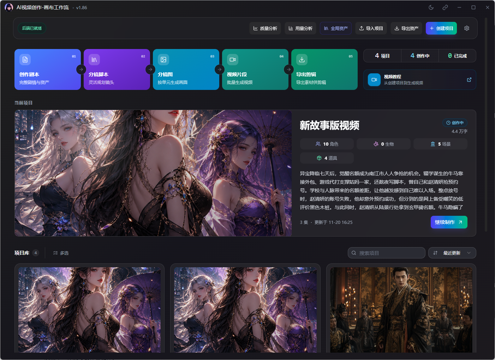
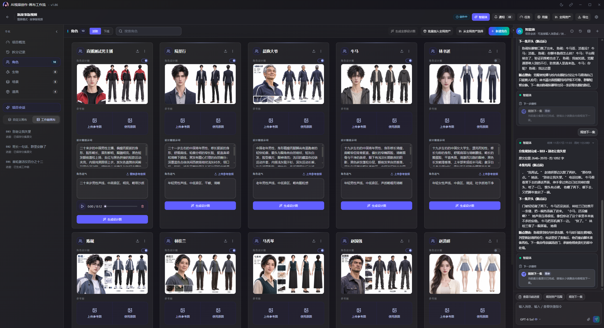
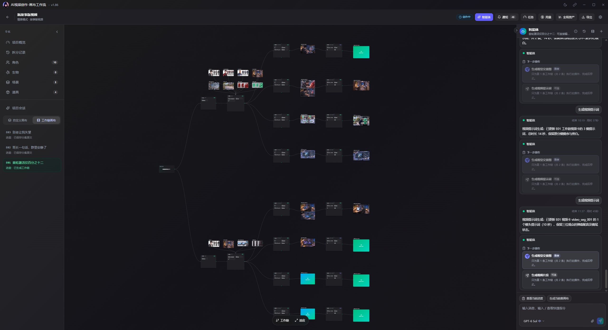

# AI视频创作-画布工作流

在 **小蜗工具** 中，把故事、角色、分镜、图片和视频串成可视化创作工作流。你可以直接安装应用开始创作，也可以获取完整源码，在小蜗里开发属于自己的应用。

**[下载小蜗工具](https://www.xiaowoai.com/ask/info/94)** · **[GitHub 源码](https://github.com/DonghuaLuo/xiaowo-ai-video)** · **[Gitee 源码](https://gitee.com/donghuax/xiaowo-ai-video)**

当前源码版本：**1.87**。下面分两步介绍如何获取源码，以及如何将它变成自己的开发应用。

## 第一步：获取源码

### 方式一：在小蜗工具中安装应用，直接获得源码（推荐）

**1. 下载并安装小蜗工具。**

打开 [小蜗工具官网下载页](https://www.xiaowoai.com/ask/info/94)，下载安装新版小蜗工具，然后启动客户端。

**2. 安装「AI视频创作-画布工作流」。**

进入左侧的「视频处理」，找到 **AI视频创作-画布工作流**，点击「安装」，等待下载完成。


**3. 打开应用目录，查看源码。**

安装完成后进入「应用管理」，找到刚安装的应用，点击「应用目录」。打开的文件夹中就包含 `backend` 后端源码、`frontend` 前端源码和 `manifest.json` 配置清单。

**安装应用后，就已经获得了一份源码。** 你可以直接阅读；准备修改和开发时，按第二步复制到自己的开发应用中。


**4. 点击「启动」，体验创作流程。**

项目首页集中管理创作项目，从故事与剧本开始，逐步进入分镜、图片、视频和导出流程。



角色页面集中维护角色设定、设计图、参考图和声音，方便在后续镜头中复用角色资产。



工作链画布把各创作环节及其素材连接起来，可以查看节点之间的关系，并结合智能体推进创作。模型服务及其凭据可在应用设置中配置。



### 方式二：从 GitHub 或 Gitee 获取源码

打开 [GitHub 仓库](https://github.com/DonghuaLuo/xiaowo-ai-video) 或 [Gitee 仓库](https://gitee.com/donghuax/xiaowo-ai-video)，下载 ZIP 并解压，也可以使用 Git 克隆：

```sh
git clone https://github.com/DonghuaLuo/xiaowo-ai-video.git
```

国内用户也可以从 Gitee 克隆：

```sh
git clone https://gitee.com/donghuax/xiaowo-ai-video.git
```

两种方式获取的都是本应用的完整前后端源码，任选一种即可；需要对照代码时，请选择相同版本。获取后，确认源码根目录下直接包含 `backend`、`frontend` 和 `manifest.json`，接着按第二步导入自己的应用。

## 第二步：创建应用并导入源码，开始开发

### 1. 先在小蜗工具中创建自己的应用

登录小蜗工具，进入左侧「应用开发」。首次使用时，按客户端提示开通开发者并完成开发环境初始化，然后点击右上角的「创建应用」。

按照图6填写：

- **分类**：选择「视频处理」。
- **ID**：填写一个未被占用的新 ID，例如 `my-ai-video`。以字母开头，可使用字母、数字和连字符，不能以连字符结尾。
- **标题与描述**：填写自己的应用名称和功能介绍。
- **前端类型**：选择图中的「主题React」，后端使用默认的 Python。

点击「创建应用」，等待创建完成。


**这一步会在服务端创建属于当前账号的应用记录，同时在本机生成对应的模板目录。** 创建成功后，应用就会出现在「应用开发」列表中；后续导入源码，是为这条应用记录替换本地程序。只有本地文件、没有当前账号对应的服务端应用记录，无法完成这条开发流程。

### 2. 打开新应用的项目目录，清空默认模板

在「应用开发」列表中找到刚创建的应用，点击「项目目录」。以 `my-ai-video` 为例，打开的是小蜗数据目录下的 `plugins_dev/my-ai-video`。

清空这个新应用目录中的默认模板内容，保留外层的 `my-ai-video` 文件夹，接下来把获取到的源码放进这里。

### 3. 将获取到的源码复制进来

从第一步得到的源码目录中，将以下内容复制到新应用的项目目录：

- `backend`、`frontend` 两个完整源码目录。
- `manifest.json` 配置清单。
- `LICENSE`、`COPYRIGHT`、`THIRD_PARTY_NOTICES.md` 等许可与版权文件，以及 `release_rules.json`。

复制的是源码目录里面的内容，放好后的结构应当如下：

```text
plugins_dev/
└── my-ai-video/
    ├── backend/
    ├── frontend/
    ├── manifest.json
    ├── LICENSE
    ├── COPYRIGHT
    ├── THIRD_PARTY_NOTICES.md
    └── release_rules.json
```

应用根目录下直接放置 `backend`、`frontend` 和清单文件。从已安装应用复制时，略过 `backend/data`、缓存及 `frontend/node_modules` 等运行数据与依赖目录；自己的项目数据和模型服务配置在新应用中另行设置。

### 4. 将配置清单的 ID 改为新应用 ID

打开新应用根目录的 `manifest.json`，将根节点的 `id` 从 `ai-video` 改为创建应用时填写的 ID：

```diff
-  "id": "ai-video",
+  "id": "my-ai-video",
```

保留清单中的其他运行配置。创建时小蜗已经按新 ID 生成了目录，导入后确认以下三处一致：

| 位置 | 本例中的值 |
| --- | --- |
| 小蜗中创建的应用 ID | `my-ai-video` |
| 项目目录名 | `my-ai-video` |
| `manifest.json` 的 `id` | `my-ai-video` |

### 5. 配置新应用的后端 SDK 公钥

每个应用都有自己的公钥，用于校验宿主发给后端的调用。导入源码后，需要将原应用的公钥换成新应用的公钥：

1. 回到「应用开发」，在新应用卡片上点击「开发管理」。
2. 找到「公钥」，点击复制。
3. 打开新应用中的 `backend/utils/xiaowo_sdk.py`，找到 `public_key` 赋值行，将引号中的内容替换为刚复制的新应用公钥，保留其余代码。

这一步让复制后的后端与自己的新应用正确关联。

### 6. 刷新应用列表，启动并开始修改

保存文件，回到「应用开发」点击刷新。小蜗识别到新目录中有效的配置清单后，就可以从这张应用卡片点击「启动」，运行自己的开发版本。

保留清单中的 `dev.frontend.entry` 为 `"auto"`。小蜗启动开发应用时会检查前端依赖，按需安装并启动前端开发服务器；首次启动请等待终端中的依赖安装与启动过程完成，并保持该开发终端运行。后端依赖和扩展运行时按客户端提示准备。

接下来即可在自己的项目目录中开发：

- 修改 `frontend/src` 中的界面代码，通过开发服务器查看更新。
- 修改 `backend` 中的业务逻辑后，重启开发应用查看效果。
- 应用标题、描述和图标等资料，在自己的「开发管理」中维护。

本仓库前端已随附小蜗 SDK，引用位于 `frontend/vendor/xiaowo-sdk`。若使用安装版源码，前端仍引用 `link:../../../packages/xiaowo-sdk` 且本机缺少该目录，可从本仓库一并复制 `frontend/vendor`、`frontend/package.json`、`frontend/pnpm-lock.yaml` 和 `frontend/pnpm-workspace.yaml`，使用仓库内的 SDK 依赖配置。

准备分发修改后的前端时，在该应用的 `frontend` 目录执行 `pnpm build`，生成的页面会写入 `frontend/dist`。完整应用通过小蜗宿主运行和调试。

---

本项目原创代码采用 **AGPL-3.0-only**，见 [LICENSE](LICENSE) 与 [COPYRIGHT](COPYRIGHT)。随附小蜗 SDK 保留 MIT 许可证，依赖许可说明见 [THIRD_PARTY_NOTICES.md](THIRD_PARTY_NOTICES.md)。
