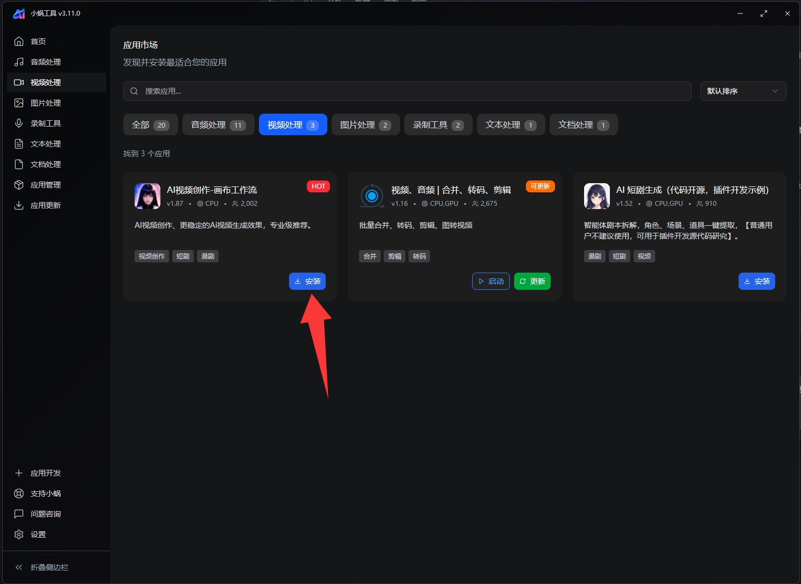
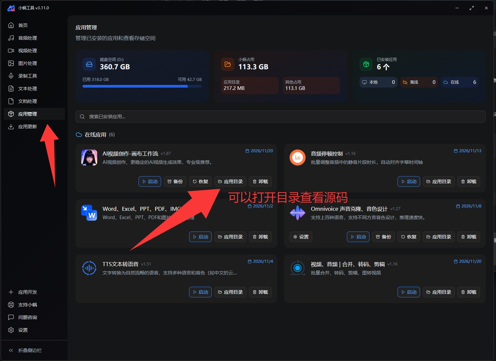

# AI视频创作-画布工作流

**小蜗工具中的开源 AI 视频创作应用。** 从故事、角色到分镜、图片和视频，在同一张画布上组织创作流程。

**下载安装即可使用，安装目录中就有源码；想做自己的应用，也可以复制源码继续开发。**

## 第一步：获取源码，体验应用

1. **[下载小蜗工具](https://www.xiaowoai.com/ask/info/94)**，在下载页选择「新版」，安装并打开。
2. 进入「视频处理」，找到 **AI视频创作-画布工作流**，点击「安装」。

3. 安装后进入「应用管理」：点击「启动」使用应用，点击「应用目录」查看源码。前端在 `frontend`，后端在 `backend`。

生成内容前，在应用设置中配置相应的模型服务。

也可以从 [GitHub](https://github.com/DonghuaLuo/xiaowo-ai-video) 或 [Gitee](https://gitee.com/donghuax/xiaowo-ai-video) 克隆或下载 ZIP。两种方式都能获取本应用源码，请按相同版本对照。

## 第二步：创建自己的应用，开始开发

**先在小蜗中创建应用，再导入源码。** 首次进入「应用开发」时，按提示开通开发者并初始化开发环境。

1. **创建应用。** 进入「应用开发」→「创建应用」，填写自己的名称和新 ID（如 `my-ai-video`），分类选择「视频处理」，前端选择「主题React」，后端使用 Python。

2. **导入源码。** 在新应用卡片点击「项目目录」，清空默认模板内容，保留外层目录。把获取到的 `backend`、`frontend`、`manifest.json` 及许可文件复制进来；一并保留 `release_rules.json`。
3. **修改 ID。** 将 `manifest.json` 的 `id` 改为新 ID，确保它与创建时填写的 ID、目录名一致，例如都为 `my-ai-video`。
4. **替换公钥。** 在新应用的「开发管理」中复制「公钥」，填入 `backend/utils/xiaowo_sdk.py` 的 `public_key` 赋值行。
5. **刷新并启动。** 回到「应用开发」刷新，点击「启动」。按提示等待依赖准备完成，即可运行自己的开发版本。

修改界面从 `frontend/src` 开始，修改后端逻辑从 `backend` 开始。自己的应用名称、描述和图标在「开发管理」中设置。

[查看完整开发指南：导入目录、配置与启动说明](docs/DEVELOPMENT.md)

### 看看应用能做什么

**项目首页：** 管理故事与创作项目，衔接剧本、分镜、图片和视频。

**角色管理：** 集中维护角色设定、设计图和声音，让角色资产可以复用。

**工作链画布：** 把素材和创作步骤连接起来，结合智能体推进创作。

**想体验或分享？[从小蜗工具官网下载开始](https://www.xiaowoai.com/ask/info/94)，安装「AI视频创作-画布工作流」。**

---

当前源码版本 **1.87**，采用 [AGPL-3.0-only](LICENSE)。随附 SDK 的 MIT 许可及其他依赖说明见 [THIRD_PARTY_NOTICES.md](THIRD_PARTY_NOTICES.md)。
