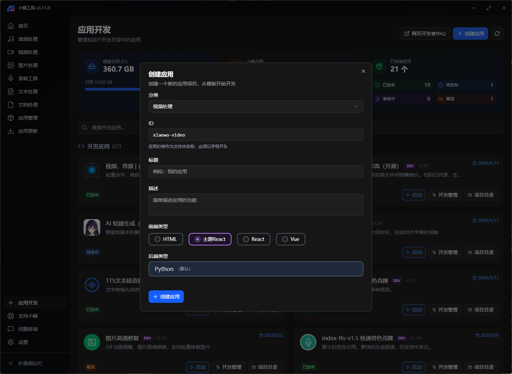

# AI视频创作-画布工作流

**小蜗工具中的开源 AI 视频创作应用。** 从故事、角色到分镜、图片和视频，在同一张画布上组织创作流程。

**下载安装即可使用，安装目录中就有源码；想做自己的应用，也可以复制源码继续开发。**

## 第一步：获取源码

**方式一：直接从 Git 获取源码。**

从下面任一仓库克隆，或下载 ZIP 并解压，即可获取源码：

- [GitHub：DonghuaLuo/xiaowo-ai-video](https://github.com/DonghuaLuo/xiaowo-ai-video)
- [Gitee：donghuax/xiaowo-ai-video](https://gitee.com/donghuax/xiaowo-ai-video)

**方式二：下载小蜗工具，安装应用后获取源码。**

1. 下载小蜗工具：[https://www.xiaowoai.com/ask/info/94](https://www.xiaowoai.com/ask/info/94)，选择「新版」，安装并打开。
2. 进入「视频处理」，找到 **AI视频创作-画布工作流**，点击「安装」。

3. 安装后进入「应用管理」，找到刚安装的 **AI视频创作-画布工作流**，点击「应用目录」。这个目录中的 `frontend`、`backend` 和 `manifest.json` 就是接下来要复制的源码与配置。

两种方式都能获取本应用源码，任选一种即可，请按相同版本对照。

## 第二步：创建自己的应用，开始开发

**先下载并安装小蜗工具，已安装的直接打开。** 下载地址：[https://www.xiaowoai.com/ask/info/94](https://www.xiaowoai.com/ask/info/94)（选择「新版」）。

小蜗官网应用快速开发指南：[https://www.xiaowoai.com/ask/devdoc/55](https://www.xiaowoai.com/ask/devdoc/55)。

**先在小蜗中创建应用，再导入源码。** 首次进入「应用开发」时，按提示开通开发者并初始化开发环境。

1. **创建应用。** 进入「应用开发」→「创建应用」，填写自己的名称和新 ID（如 `my-ai-video`），分类选择「视频处理」，前端选择「主题React」，后端使用 Python。

2. **替换新应用的源码。** 创建完成后，在「应用开发」页面找到这个新应用，点击它的「项目目录」。清空其中的默认模板内容，保留外层目录，再把第一步获得的 `backend`、`frontend`、`LICENSES` 三个目录及 `manifest.json` 复制进来，一并保留 `release_rules.json`。`LICENSES` 中包含 `LICENSE.txt`、`COPYRIGHT.txt` 等版权材料。
3. **获取新应用的 ID 和公钥。** 回到「应用开发」，点击这个新应用的「开发管理」，进入管理页面，复制该应用的 **ID** 和 **公钥**。
4. **替换两处配置。** 用刚复制的新应用 ID 替换 `manifest.json` 中的 `id`；用新应用公钥替换 `backend/utils/xiaowo_sdk.py` 中的 `public_key`。新应用目录名也应与这个 ID 一致。
5. **启动自己的应用。** 保存后回到「应用开发」刷新，找到这个新应用，点击「启动」。按提示等待依赖准备完成，即可开始开发。

修改界面从 `frontend/src` 开始，修改后端逻辑从 `backend` 开始。自己的应用名称、描述和图标在「开发管理」中设置。

[查看完整开发指南：导入目录、配置与启动说明](docs/DEVELOPMENT.md)

### 看看应用能做什么

**项目首页：** 管理故事与创作项目，衔接剧本、分镜、图片和视频。

**角色管理：** 集中维护角色设定、设计图和声音，让角色资产可以复用。

**工作链画布：** 把素材和创作步骤连接起来，结合智能体推进创作。

**想体验或分享？[从小蜗工具官网下载开始](https://www.xiaowoai.com/ask/info/94)，安装「AI视频创作-画布工作流」。**

---

当前源码版本 **1.87**，采用 [AGPL-3.0-only](LICENSES/LICENSE.txt)。版权声明见 [COPYRIGHT.txt](LICENSES/COPYRIGHT.txt)，随附 SDK 的 MIT 许可及其他依赖说明见 [THIRD_PARTY_NOTICES.md](LICENSES/THIRD_PARTY_NOTICES.md)。
