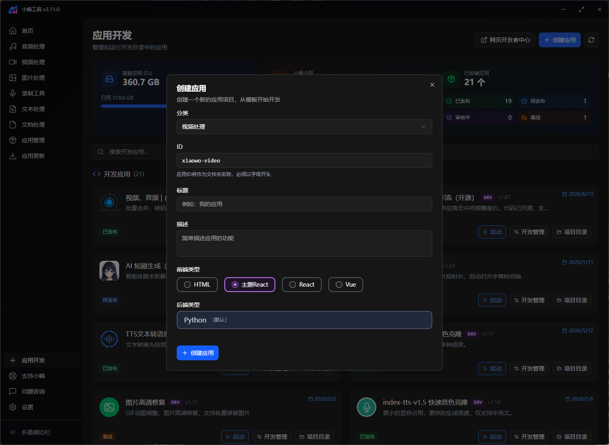

# 开发指南

先按 [首页第一步](../README.md) 获取源码：直接从 Git 获取，或在小蜗安装「AI视频创作-画布工作流」后，从「应用管理 → 应用目录」获取。

开发前先下载并安装小蜗工具，已安装的直接打开。下载地址：[https://www.xiaowoai.com/ask/info/94](https://www.xiaowoai.com/ask/info/94)（选择「新版」）。

小蜗官网应用快速开发指南：[https://www.xiaowoai.com/ask/devdoc/55](https://www.xiaowoai.com/ask/devdoc/55)。

下面进入「应用开发」，创建自己的新应用，再把获取到的源码导入这个新应用的「项目目录」。

### 1. 先在小蜗工具中创建自己的应用

登录小蜗工具，进入左侧「应用开发」。首次使用时，按客户端提示开通开发者并完成开发环境初始化，然后点击右上角的「创建应用」。

按照图6填写：

- **分类**：选择「视频处理」。
- **ID**：填写一个未被占用的新 ID，例如 `my-ai-video`。以字母开头，可使用字母、数字和连字符，不能以连字符结尾。
- **标题与描述**：填写自己的应用名称和功能介绍。
- **前端类型**：选择图中的「主题React」，后端使用默认的 Python。

点击「创建应用」，等待创建完成。



**这一步会在服务端创建属于当前账号的应用记录，同时在本机生成对应的模板目录。** 创建成功后，应用就会出现在「应用开发」列表中；后续导入源码，是为这条应用记录替换本地程序。只有本地文件、没有当前账号对应的服务端应用记录，无法完成这条开发流程。

### 2. 打开新应用的项目目录，清空默认模板

在「应用开发」列表中找到刚创建的应用，点击「项目目录」。以 `my-ai-video` 为例，打开的是小蜗数据目录下的 `plugins_dev/my-ai-video`。

清空这个新应用目录中的默认模板内容，保留外层的 `my-ai-video` 文件夹，接下来把获取到的源码放进这里。

### 3. 将获取到的源码复制进来

从第一步得到的源码目录中，将以下内容复制到新应用的项目目录：

- `backend`、`frontend` 两个完整源码目录。
- `manifest.json` 配置清单。
- `requirements.txt` 后端 Python 依赖清单；安装版目录中若没有该文件，请从 [本仓库](../requirements.txt) 补齐。
- 完整的 `LICENSES` 目录，其中包含 `LICENSE.txt`、`COPYRIGHT.txt` 和依赖许可说明；同时复制 `release_rules.json`。

复制的是源码目录里面的内容，放好后的结构应当如下：

```text
plugins_dev/
└── my-ai-video/
    ├── backend/
    ├── frontend/
    ├── manifest.json
    ├── requirements.txt
    ├── LICENSES/
    │   ├── LICENSE.txt
    │   ├── COPYRIGHT.txt
    │   └── THIRD_PARTY_NOTICES.md
    └── release_rules.json
```

应用根目录下直接放置 `backend`、`frontend` 和清单文件。从已安装应用复制时，略过 `.venv`、`backend/data`、缓存及 `frontend/node_modules` 等运行数据与依赖目录；自己的项目数据和模型服务配置在新应用中另行设置。

应用中的版权材料统一放在 `LICENSES/`，清单的 `open_source` 路径与该目录中的文件对应。仓库根目录的 `LICENSE` 用于 Git 平台识别项目许可证；导入应用时复制完整的 `LICENSES` 目录。

### 4. 从新应用的「开发管理」获取 ID 和公钥

源码替换完成后，回到「应用开发」页面，找到刚创建的新应用，点击它的「开发管理」。进入管理页面，复制这个新应用的 **ID** 和 **公钥**，用于修改刚导入的源码。

### 5. 替换配置清单中的 ID 和后端 SDK 中的公钥

打开新应用项目目录中的 `manifest.json`，将根节点的 `id` 从 `ai-video` 改为从新应用「开发管理」中复制的 ID。以 `my-ai-video` 为例：

```diff
-  "id": "ai-video",
+  "id": "my-ai-video",
```

创建时小蜗已经按新 ID 生成了目录，导入后确认以下三处一致：

| 位置 | 本例中的值 |
| --- | --- |
| 新应用「开发管理」中的 ID | `my-ai-video` |
| 项目目录名 | `my-ai-video` |
| `manifest.json` 的 `id` | `my-ai-video` |

接着打开同一个新应用目录中的 `backend/utils/xiaowo_sdk.py`，找到 `public_key` 赋值行，将引号中的内容替换为刚才从新应用「开发管理」中复制的公钥，保留其余代码。

完成这两处替换后，导入的源码就使用了新应用的 ID 和公钥。

### 6. 指定开发后端的 Python，并安装依赖

准备 Python 3.10，在新应用的项目根目录打开 PowerShell，执行：

```powershell
py -3.10 -m venv .venv
& ".\.venv\Scripts\python.exe" -m pip install -r requirements.txt
```

这会在当前项目的 `.venv` 目录创建独立 Python 环境，并安装 [requirements.txt](../requirements.txt) 中的依赖。该文件由本地 Windows / Python 3.10.20 开发后端环境导出，锁定了当前安装版本，排除了仅用于本机环境打包的 Conda 路径项。

打开 `manifest.json`，将 `dev.backend` 配置为：

```json
"dev": {
  "frontend": {
    "entry": "auto"
  },
  "backend": {
    "runtime": ".venv/Scripts/python.exe",
    "use_local_runtime": false,
    "args": ["--dev"]
  }
}
```

仓库已提供上述配置。`runtime` 相对于应用项目根目录解析，也可以填写已有环境的绝对路径，例如 `D:/PythonEnvs/my-ai-video/python.exe`。使用已有环境时，略过创建 `.venv` 的命令，改用该 Python 安装依赖：

```powershell
& "D:/PythonEnvs/my-ai-video/python.exe" -m pip install -r requirements.txt
```

请按本机实际位置修改路径。**安装依赖所用的 Python 必须与 `dev.backend.runtime` 指向同一个解释器。** `use_local_runtime: false` 使开发后端使用这里指定的路径；该开发配置会覆盖正式的 `backend` 配置。修改后保存清单，刷新应用开发列表并重新启动应用。

### 7. 刷新应用列表，启动并开始修改

保存文件，回到「应用开发」点击刷新，找到刚创建的新应用，点击它的「启动」，运行自己的开发版本。

保留清单中的 `dev.frontend.entry` 为 `"auto"`。小蜗启动开发应用时会检查前端依赖，按需安装并启动前端开发服务器；首次启动请等待终端中的依赖安装与启动过程完成，并保持该开发终端运行。开发后端使用上一步配置的 Python，请提前在该环境安装后端依赖。

接下来即可在自己的项目目录中开发：

- 修改 `frontend/src` 中的界面代码，通过开发服务器查看更新。
- 修改 `backend` 中的业务逻辑后，重启开发应用查看效果。
- 应用标题、描述和图标等资料，在自己的「开发管理」中维护。

本仓库前端已随附小蜗 SDK，引用位于 `frontend/vendor/xiaowo-sdk`。若使用安装版源码，前端仍引用 `link:../../../packages/xiaowo-sdk` 且本机缺少该目录，可从本仓库一并复制 `frontend/vendor`、`frontend/package.json`、`frontend/pnpm-lock.yaml` 和 `frontend/pnpm-workspace.yaml`，使用仓库内的 SDK 依赖配置。

准备分发修改后的前端时，在该应用的 `frontend` 目录执行 `pnpm build`，生成的页面会写入 `frontend/dist`。完整应用通过小蜗宿主运行和调试。

---

本项目原创代码采用 **AGPL-3.0-only**，见 [LICENSE.txt](../LICENSES/LICENSE.txt) 与 [COPYRIGHT.txt](../LICENSES/COPYRIGHT.txt)。随附小蜗 SDK 保留 MIT 许可证，依赖许可说明见 [THIRD_PARTY_NOTICES.md](../LICENSES/THIRD_PARTY_NOTICES.md)。
